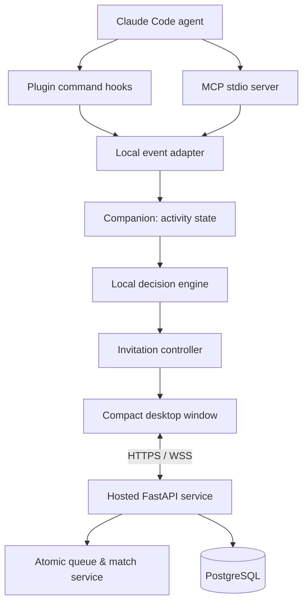
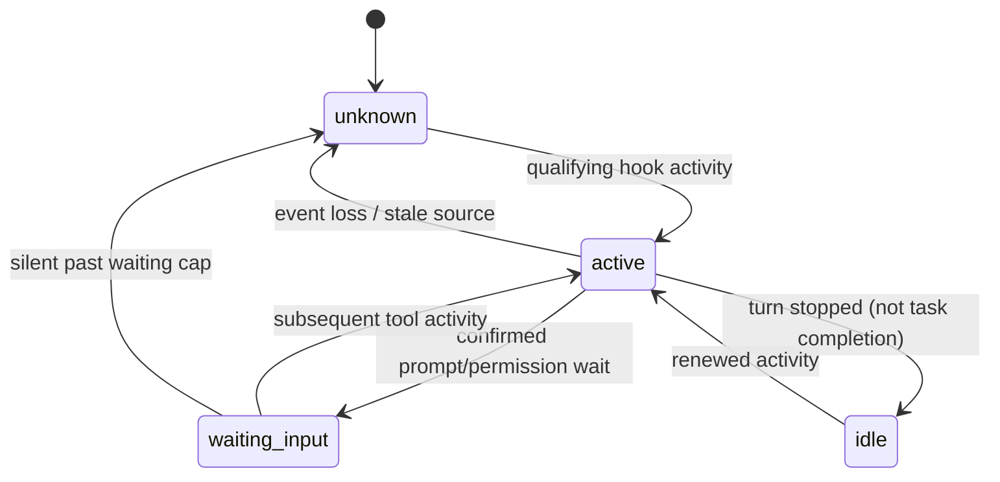

# Breakroom — MVP Architecture Specification

**Status:** Draft v0.1, engineering proposal (not an authorization to implement)  
**Date:** 2026-10-12  
**Scope:** Claude Code-first, open-source-oriented, invite-only hosted beta  
**Product concept:** A voluntary, spontaneous one-to-one chat break while AI coding agents work.

> **Decision status convention:** **CONFIRMED** means agreed during the twelve-question product interview. **PROPOSED** means a technical/default choice for review, and must not be mistaken for user approval. **DEFERRED** means explicitly outside the first MVP.

## 1. Product constraints and Round 1 decisions

All twelve product decisions are **CONFIRMED**:

| # | Domain | Decision |
|---|---|---|
| 1 | Invitation | Automatically detect possible breaks; entry remains opt-in |
| 2 | Detection | Hybrid: initial task-duration estimate plus observed activity |
| 3 | AI | Local-first decisions with reliable heuristic fallback |
| 4 | Interface | Independent, compact desktop chat window |
| 5 | Duration | Temporary conversation by default, mutually extendable; show task/break countdowns |
| 6 | Matching | Availability first, stack similarity second |
| 7 | Privacy | Analyze locally; share only allowlisted, explicitly approved sanitized metadata |
| 8 | Identity | Persistent pseudonymous account/profile |
| 9 | Scarcity | Bounded queue for one-to-one matching; no group room in MVP |
| 10 | Integration | Claude Code first; Codex adapter later |
| 11 | Distribution | Claude Code plugin and separately installed companion application |
| 12 | Launch | Local verification, then a small closed beta |

**Open-source preference:** Raised after Question 12; **PROPOSED** approach is public source code, restricted hosted beta. License: Apache-2.0 (**CONFIRMED** 2026-10-12). Open source and access to the hosted network are separate decisions.

### Problem statement

Developers with coding agents often have short intervals when the agent is executing autonomously. The product detects a likely interval, offers an optional social break, and matches consenting developers for a short one-to-one conversation. The system should feel like a cigarette/coffee break at work, not a meeting planner, social network, or agent-agent discussion tool.

### MVP success hypothesis

Some developers will accept unobtrusive invitations, meet an available peer, and choose to repeat the experience. The beta tests **demand and timing** as well as technical feasibility.

### Explicit non-goals

- Multi-user group chats, audio/video calls, public timelines, reactions, leaderboards, follow counts.
- Guaranteed execution-time predictions or claims of precise completion times.
- Uploading repository contents, prompts, plan text, shell commands, or file paths.
- A hard dependency on locally installed AI model weights.
- Codex support in the first complete vertical slice.
- Agent-to-agent conversation; use the chat window for people only.
- A commercial subscription system or production-scale federated network.
- Automatic sharing of task descriptions with chat partners.
- Full self-hosting support documentation for the initial closed beta (architecture should permit later support).

## 2. Proposed technology decisions

**All decisions in this section are PROPOSED, not confirmed.** They favor a Python-first repository and reasonable contributor onboarding.

| Component | Proposal | Rationale / tradeoff |
|---|---|---|
| Language | Python 3.12+ | Core backend, agent integration, local engine, and desktop code share types and tests |
| MCP server | Official `mcp` Python SDK v2, `MCPServer`, stdio | Matches current SDK; MCP tool invocation is not our activity-observation mechanism |
| Claude Code integration | Plugin manifest + command hooks + local stdio MCP process | One shareable integration package with explicit activation |
| Companion UI | PySide6 / Qt | Small native-like window, tray/notifications, mostly Python; larger packages and platform packaging need validation |
| Companion async | Qt main thread + managed background async worker | Never block UI on inference, network calls, or retries; choose qasync only if integration tests justify it |
| Local IPC | Authenticated, loopback-only HTTP at a random bound port | Portable baseline; alternatives are OS-local sockets/pipes, which are harder cross-platform |
| Backend | FastAPI + Pydantic + async WebSockets | One Python service for HTTP APIs, socket connections, and schemas |
| Persistence | PostgreSQL + SQLAlchemy + Alembic | Transactions and constraints for account/session/match invariants |
| Distributed infrastructure | Single service instance initially; no Redis | Avoid premature complexity; introduce Redis/pubsub if multiple instances become necessary |
| Test/tooling | pytest, Ruff, mypy or pyright, property tests, migration tests | Predictable contract and behavior testing |
| Packaging | `uv` in development; signed/package-verified companion builds per OS later | Stable dependency sets; distribute runnable software rather than requiring source setup |
| Beta auth | Invite-only email sign-in, private email and public nickname | Simple access control without mandatory GitHub identity; select provider during implementation review |
| Beta auth, M3 (**CONFIRMED** 2026-10-13) | Self-hosted: admin-CLI invite bound to an email, 8-character one-time code by email typed into the companion; opaque access (15 min) and rotating refresh (30 days) tokens, stored hashed; refresh reuse revokes the device (M6-05: a retry within 30 s gets the same pair back) | No identity vendor; no links or URL-scheme handoff from a desktop app; revocation is a row update |
| License | Apache-2.0 (**CONFIRMED** 2026-10-12) | Permissive source distribution with explicit patent terms; dependency compliance review still applies, e.g. PySide6 is LGPL |

**Platform decision (CONFIRMED 2026-10-12):** M1 targets WSL2 Linux end to end — Claude Code, hooks, MCP server, companion (GUI via WSLg) and local IPC all run inside WSL. This supersedes the Windows-first proposal below for M1; later platforms remain open (ADR #2).

**M3 decisions (CONFIRMED 2026-10-13):** local Docker only (Postgres, Mailpit, server, ports bound to `127.0.0.1`); the companion keeps its refresh token in the OS keyring, or a `0600` file in its private state directory when no keyring backend works (shown to the user); privacy consent per field (category, stack tags, time bucket), all off by default, stored server-side with version and time; nicknames ASCII `[A-Za-z0-9_-]{3,24}` after NFKC, unique by a confusable skeleton; M3 sends no task metadata, only an authenticated connection with heartbeats.

**Local IPC decision (CONFIRMED 2026-10-12, M1):** a Unix domain socket in a `0700` runtime directory replaces loopback HTTP, because WSL2 forwards `127.0.0.1` listeners to Windows. Other platforms revisit this under ADR #3.

**Original platform proposal:** Test Windows first in the earliest hands-on prototype, then Windows and Linux for a closed beta if support capacity permits, with macOS added after packaging validation. This is **not** a confirmed scope decision. Native Windows, WSL, remote/SSH Claude Code, and macOS differ in where hooks execute; initial behavior must be specified/tested rather than presumed.

**Documentation accuracy note:** The official MCP Python SDK stable v2 uses `from mcp.server import MCPServer`. Older examples using `FastMCP` represent the prior SDK. Exact plugin and hook JSON shall be validated against the installed Claude Code version before release.

## 3. Component responsibilities



### 3.1 Plugin

- Supplies Claude Code lifecycle hooks (e.g., `SessionStart`, `UserPromptSubmit`, `PostToolUse`, `TaskCreated`, `TaskCompleted`, `Stop`, `SessionEnd`) where supported.
- Each hook processes incoming JSON **locally** and forwards only the minimal extracted, approved event data to the companion; it must never send whole hook payloads to the hosted server.
- Supplies a **real stdio MCP server** for agent-facing capabilities such as checking break status or changing a requested availability setting. It does not own conversations or maintain remote chat sockets.
- Emits no unsolicited large responses to Claude and does not force prompt context injection.
- Uses fire-and-forget/asynchronous or strictly bounded behavior where supported. Failure must not block agent activity.

### 3.2 Companion

- Owns local state, activity interpretation, queue UI, invitations, timers, personal settings, and encrypted/secured sign-in credentials.
- Runs heuristics by default; an optional local model can score candidate break opportunities using **sanitized local signals**.
- Enforces consent and export allowlists before any remote request.
- Connects to the hosted service only after explicit login and applicable network/privacy permissions.
- Provides offline diagnostics and a user-visible export preview: **“What this app shares.”**
- Keeps chat independent of the coding-agent prompt/context.

### 3.3 Hosted backend

- Handles authentication, invitation eligibility for a closed beta, profile nickname, presence, queue, match sessions, blocking/reporting, and one-to-one messages.
- Receives only explicitly allowed task categories/tags and broad time availability; it must not accept or store prompt bodies or local file paths as structured task data.
- Enforces server-side authority over account, queue membership, chat participants, and session expiration.
- Manages concurrency, reconnections, and idempotency independently of client timeouts.

## 4. Privacy and trust boundaries

**Protected local content:** raw prompts, source code, command arguments, tool results, full plans, stack traces, secret/env values, absolute/relative repository paths, workspace/repository names, detailed file names, and Claude session identifiers.

**Outbound allowlisted metadata (proposal):**

```json
{
  "schema_version": 1,
  "presence_id": "opaque-random-per-break",
  "task_category": "backend",
  "stack_tags": ["python", "fastapi"],
  "remaining_time_bucket": "10-20m",
  "status": "available"
}
```

The fields `task_category`, `stack_tags`, and time bucket are individually configurable; with technical-sharing disabled, send only queue presence and a coarse, user-approved availability window. Time buckets avoid false precision. The backend associates the presence with an authenticated pseudonymous account internally; the `presence_id` is not a security credential.

**Sent at sign-in (M6, CONFIRMED 2026-10-16):** the email, later the nickname, and a device name. The device name is shown and editable on the code page before sign-in (default `WSL device`; 1–40 letters, digits, space, `.`, `_`, `-`) and listed in the privacy preview under "Sent when you sign in". The machine hostname is never read or sent. There is no rename after sign-in.

**Rules:**

1. Local hook input may contain sensitive data, so the adapter must parse with an explicit field allowlist; never forward or log raw events.
2. Stack tags come from a controlled vocabulary; never copy guessed/free-form repository titles or task text into tags.
3. Require explicit privacy settings during onboarding, separate from a per-break acceptance action. No remote presence before both gates pass.
4. No raw prompt text, shell commands, or tool results in telemetry, exceptions, or debug logs. Redact event attributes before logging.
5. Treat all local inference outputs as untrusted: validate enums, lengths, vocabulary, and source provenance in deterministic code.
6. Desktop UI shows a preview of outgoing data; configuration changes take effect before the next outbound event.
7. Local model inference is opt-in/configurable and **never required** for normal agent or break-room operation.
8. Do not advertise end-to-end encrypted chat. TLS/WSS protects transport, but ordinary server-side chat storage/processing is readable by the service operator. E2EE is deferred.
9. Enforce outbound network allowlists to the configured service endpoint; never allow prompts or hook JSON to become arbitrary destinations.

**Hard security issue:** Local HTTP is not automatically safe because other processes on the same device may access it. Bind only to `127.0.0.1`, use an unpredictable local bearer token stored with restrictive OS permissions, reject inappropriate Origin/CORS requests, cap request sizes, validate the caller, and define a token-rotation policy. Investigate domain-socket/named-pipe security before calling this production-ready.

## 5. Normalized local event contract

Sample event, with strictly non-sensitive fields:

```json
{
  "event_version": 1,
  "event_id": "uuidv4",
  "local_session_key": "ephemeral-local-only",
  "agent": "claude_code",
  "type": "tool_completed",
  "observed_at": "2026-10-12T13:20:00Z",
  "tool_class": "file_edit"
}
```

Allowed event types for v0: `session_opened`, `turn_submitted`, `tool_started`, `tool_completed`, `task_created`, `task_completed`, `waiting_input`, `turn_stopped`, `session_closed`, `heartbeat` (internal). `waiting_input` comes from permission prompts and MCP elicitations; failed tools count as `tool_completed` and API-error turn ends as `turn_stopped` (**CONFIRMED** 2026-10-12, M2). Tool classes are broad categories (`file_edit`, `shell`, `read`, `other`) and never reveal commands or file paths. If a hook cannot provide a classification safely, use `other`.

- Raw Claude session ID may be needed to correlate events **on the developer's machine**. Normalize it to an internal ephemeral key; never send that identifier to the backend.
- Use `event_id` for de-duplication. Hook events may arrive out of order or not at all; activity handling must tolerate both.
- Distinguish a Claude **turn stop** from completed user work: a `Stop` event means the response stopped, *not* that a multi-turn coding task was finished.
- Do not infer that absence of hooks means the agent is executing. A missing stream becomes `unknown` after a timeout.

## 6. State machines and invariants

### 6.1 Activity state (local)



M2 (**CONFIRMED** 2026-10-12): `idle` does not go stale; silent sessions are forgotten after a bound instead. Do **not** assert `waiting_input` based merely on long tool silence. Use only explicit supported signals or display `uncertain`. `TaskCompleted` is a hint for a known tracked task, not a guarantee of whole-session completion.

### 6.2 Break invitation (local)

`eligible -> suggested -> [accepted | declined | timed_out] -> cooldown`

Invariants: at most one outstanding suggestion per developer; acceptance opens queue exactly once; declining never transmits task metadata to the hosted service; suppression/cooldown survives companion restarts if configured. The user can disable suggestions indefinitely.

### 6.3 Queue (server)

`not_queued -> queued -> [matched | cancelled | expired]`

Invariants: at most one active queue/match for each user across devices; admission requires valid login, allowed beta access, unblocked profile, and explicit local acceptance; the user can cancel at any point; server enforces queue TTL; fairness prevents indefinite starvation. A match is committed atomically and cannot consume a participant twice.

M4 (**CONFIRMED** 2026-10-13):

- Admission also requires a saved nickname and consent (`409 setup_incomplete`), and every presence field sent must be covered by the stored consent (`400`). The search lasts 90 s (`queue_ttl_s`); then `expired` and a "nobody available" screen, no automatic retry.
- One `queued` entry and one active match per user are enforced by partial unique indexes on both PostgreSQL and SQLite; the in-process matcher lock is only a performance aid.
- Only users with a live WebSocket are paired; a disconnected user's entry waits and expires by its TTL.
- A match (`active -> ended`) ends by either participant (End or Block), after 15 min (`match_ttl_s`; M5 makes the match the chat and adds extensions, reports and the offline hold, §6.4), or when an admin disables a participant. A blocked peer is told only `ended`.
- When an entry leaves `queued` its presence fields are nulled at once; ended rows are deleted after 30 days (`retention_s`).

### 6.4 Chat (server)

`matched -> active -> grace_period -> [extended_active | ended]`

A verified task-completion signal may start the proposed grace period, but completion is uncertain. When uncertain, show an **“agent status changed”** notice rather than claim it finished. Either participant can end or report/block at any time. Extension requests require explicit agreement by **both** parties. Chat stays available despite coding-agent disconnection during an already-established session until its independent duration policy ends.

M5 (**CONFIRMED** 2026-10-14):

- The chat *is* the match: no separate chat state machine or table. It lasts 15 min (`match_ttl_s`); the last 2 min before the deadline (`chat_grace_s`) is the grace period, in which both windows offer "Extend?". The grace period is deadline-driven: agent activity never changes the chat timer, and the chat shows nothing about either person's agent.
- An extension needs both people: one requests, the other accepts (a request while the peer's request is pending counts as accepting it). Each adds 10 min (`chat_extension_s`), at most 2 per chat (`chat_max_extensions`). Either side may decline or withdraw a pending request. The server adjudicates with conditional updates, so two accepts extend once and an accept that races the deadline loses. Extension state is reported per viewer (`none`, `requested_by_me`, `requested_by_peer`), so no frame carries an account ID.
- A participant with no connected device is *offline*. The sweep notices (1 s pass), tells the peer (`peer_offline`, then `peer_online`), and after 60 s offline (`chat_disconnect_s`) ends the chat with reason `disconnected`. The deadline keeps running while offline. The first pass after a server start resets every offline timer, so a restart never ends a chat by itself.
- A user counts as online while any device is connected; every device mirrors the chat and can send.
- End reasons stored: `ended`, `blocked`, `reported`, `expired`, `disabled`, `disconnected`. A blocked or reported peer is told only `ended`.

### 6.5 Proposed timer semantics

- **Estimate timer:** advisory only, updated with new local evidence, shown with `~` or a range. Never use reaching `00:00` alone to force a session close.
- **Session timer:** authoritative server-side deadline (UTC), displayed using a monotonic local clock with occasional synchronization; reconnections cannot reset it.
- **Grace:** suggested `2 minutes` after a *confirmed* task-finish event; otherwise ask whether to remain rather than invent completion.
- **Extension:** suggested `10 minutes` when both opt in; do not reset from a single client request.
- All concrete values are **PROPOSED defaults**, controlled from configuration/remote policy, not accepted product decisions.

M5 (**CONFIRMED** 2026-10-14): session 15 min; grace is the last 2 min before the deadline (there is no confirmed task finish to start it from); extension 10 min, at most 2, both must agree; offline hold 60 s. All are server configuration (`BREAKROOM_CHAT_*`). The deadline travels as `ends_at` (UTC) in every chat status and `match.created`/`sync`; clients show it against the server time carried by each frame.

## 7. Invitation and local decision engine

### 7.1 Always-available heuristic baseline

Signals may include elapsed observed activity, tool-call cadence, explicit waiting/stop state, current task status if available, and optional coarse plan-step count computed locally without exporting plan text.

**Proposed trigger:** after a task/turn has exhibited roughly 45–90 seconds of real activity and remaining-work evidence suggests at least several minutes, offer one invitation if user is eligible and not in cooldown. If evidence is weak, *do not* produce an invitation solely to increase engagement.

No inference runs inside a blocking agent hook. The hook posts an event and exits within a bounded deadline; the companion processes in the background.

### 7.2 Local AI adapter

Contract:

```python
class DecisionResult(BaseModel):
    invite_suitable: bool
    confidence: float  # [0, 1]; model score, not a calibrated probability
    task_category: Literal[
        "backend", "frontend", "devops", "data", "testing", "other"
    ]
    remaining_time_bucket: Literal[
        "unknown", "under_5m", "5_10m", "10_20m", "20m_plus"
    ]
    reason_code: Literal[
        "sustained_activity", "insufficient_evidence", "waiting_for_user", "other"
    ]
```

An engine can be `heuristic` or `local_model`, but both return the same validated output. The AI is not allowed to override privacy preferences, eligibility, or cooldown. Never label `confidence` as a trustworthy calibrated forecast until empirically validated.

### 7.3 Evaluation plan

- Replay identical normalized, sanitized event traces through both engines.
- Record local opt-in ground truth when a coding task actually needed human input/finished; missing or ambiguous outcomes stay `unknown`.
- Compare invitation timing, false/intrusive invitations, abstention, runtime overhead, and bucket calibration.
- Maintain a fixed regression set of short tasks, pauses, approval waits, long tasks, multiple simultaneous sessions, and dropped events.
- Enable a local model in the beta only if it improves user-relevant measures without violating performance budgets. Pin weights, hashes, licenses, and resource limits.

## 8. MCP tool surface

**Proposed minimum tools exposed to Claude Code over local stdio MCP:**

| Tool | Inputs | Output | Side effect |
|---|---|---|---|
| `breakroom_status` | none | Local activity/break status, no private chat content | none |
| `breakroom_set_suggestions` | `enabled: bool` | Effective local setting | changes local consent preference only on explicit authorized user request |
| `breakroom_open_window` | none | UI-opening acknowledgment | opens independent companion UI |
| `breakroom_leave_queue` | none | `cancelled` / `not_searching` / `unavailable` / `companion_not_running` | cancels an existing search; never ends a match (M4) |

M4: `breakroom_status` gains a fixed `queue` field (`none`/`searching`/`matched`); no peer nickname or tag reaches Claude's context. M5: `StatusReply` version 4 renames `matched` to `chatting`; the client still accepts version 3 (mapping `matched` to `chatting`) and version 2 (`queue` unknown). Claude cannot see, send to or end a chat.

Agent-facing tools should not be able to silently enroll a user into remote matchmaking: queue entry requires a **direct user acceptance in the companion UI**, independent of what the LLM requests. Tool responses must be bounded and not leak messages or peer profile details into Claude's context. Additional tools require separate acceptance criteria.

M6: the plugin depends on no venv. Hooks and the MCP server run `breakroom-hook` and `breakroom-mcp` from `PATH` (`~/.local/bin` prepended; a repo checkout's `.venv/bin` first), installed with `uv tool install --with-executables-from breakroom-agent-bridge breakroom-companion` from release wheels (`scripts/build_release.sh`). A missing hook binary exits 0 silently, so Claude execution **fails open**; a missing `breakroom-mcp` shows as a failed server in `/mcp`.

## 9. Companion ↔ backend contract

### 9.1 HTTP API (proposed)

- `POST /v1/auth/*` — beta invitation / sign-in flow (provider-specific, to be decided)
- `GET /v1/me` — private account and nickname/profile
- `PATCH /v1/me` — bounded nickname and optional interests
- `POST /v1/queue` — authenticated enqueue; idempotency key (scoped per user) required; body carries the consented `OutboundPresence`. 201, or 200 on replay; 409 `setup_incomplete` / `already_queued` / `already_matched`; per-user rate limit (M4)
- `DELETE /v1/queue/current` — cancel own queue entry; always 204 (M4)
- `POST /v1/matches/{id}/end` — leave the active match; 404 `not_found` for non-participants (M4; replaces `/v1/chat/{id}/end`, M5 hangs chat off the match)
- `POST /v1/matches/{id}/messages` — send a chat message: `client_message_id` (idempotent per user) and plain text, normalized by the server (NFC; control and bidi characters removed; at most 1000 characters; empty rejected). 201 `MessageView`, 200 on replay; 409 `chat_ended`; 20 per 10 s per user (M5)
- `GET /v1/matches/{id}/messages?after_seq=N` — the messages after sequence number N, oldest first, at most 100, plus the match's `last_seq`. Readable by participants only and only until the bodies are purged (M5)
- `POST /v1/matches/{id}/extension` — `request`/`accept`/`decline`; the server adjudicates and returns the caller's chat status. 409 `chat_ended` / `no_extensions_left` / `no_extension_request` (M5; replaces `/v1/chat/{id}/extension`)
- `POST /v1/matches/{id}/block` — end the match and block the other participant by account ID (M4; replaces `/v1/users/{id}/block`: clients never see account IDs)
- `POST /v1/reports` — file a report with explicit user-selected content/evidence. M5: `match_id`, a reason from a fixed list, an optional note (at most 500 characters) and the sequence numbers of the messages the user ticked (none by default). Reporting also blocks the peer and ends the chat. One report per user per chat, accepted up to 24 h after the chat ended (`report_window_s`). 204; 409 `already_reported` / `report_window_closed`

Every chat and report route answers 404 `not_found` both for an unknown match and for one the caller is not part of (no oracle). Request bodies are capped at 16 KiB.
- `GET /v1/privacy/export-preview` — *not necessary* if preview is purely local; don't send it remotely

### 9.2 WebSocket events (proposed)

Authenticated `WSS /v1/realtime` supports:

`queue.joined`, `queue.expired`, `match.created`, `chat.message`, `chat.message_ack`, `chat.status`, `chat.extension_requested`, `chat.extension_resolved`, `chat.ended`, `session.reconnected`.

M4 implements `sync` (sent once after the first `session.ready`: the user's current entry and match), `queue.joined`, `queue.ended` (reason `cancelled` or `expired`; this is §9.2's `queue.expired`), `match.created` and `match.ended` (reason `ended` or `expired`; a block is reported as `ended`). Queue and match frames go to every connected device of the user. Frames are best effort; the database is the truth and `sync` restores it on reconnect.

M5 implements `chat.message` (to every device of both participants, the sender's included, so the sender's other devices mirror it; `mine` and `client_message_id` are per recipient) and `chat.status` (the recipient's full chat status plus a `change`: `extension_requested`, `extension_accepted`, `extension_declined`, `peer_offline`, `peer_online`). §9.2's `chat.extension_requested` and `chat.extension_resolved` are `chat.status` changes; `chat.ended` is `match.ended` with the new reason `disconnected`; `session.reconnected` is `sync`. `chat.message_ack` is not needed: messages are sent over HTTP and the reply is the ack, so the WebSocket stays server → client only. `match.created` and `sync` carry the chat status and `last_seq`; a client that sees a gap fetches the missing messages over HTTP. No typing indicator and no delivered or read receipts. Server frames may be up to 8 KiB (`MAX_SERVER_FRAME_BYTES`, so a 1000-character message of 4-byte characters fits); client frames stay at 4 KiB. The per-socket outbound queue holds 64 frames.

All frames include `version`, `event_id`, and server-side timestamp. Chat send requests include a unique client message ID for idempotency. The server validates session membership and authorization on **every** message and operation, not just WebSocket connection setup. Bound lengths, validate Unicode/attachments, and set message rate limits.

### 9.3 Atomic matchmaking

- The service finds eligible queued peers who are mutually unblocked and have overlapping declared availability.
- Rank candidate pairs by acceptable window, wait age/fairness, and then shared stack tags. Do not require identical stacks.
- Transactionally lock/claim queue rows (e.g., PostgreSQL row locks with `SKIP LOCKED`) and create a unique match. Enforce active-session uniqueness in storage, not only in memory.
- Enqueue, match, and expiry are idempotent; reconnects must never produce two matches for one user.
- Start with a single server instance to simplify real-time routing; a horizontal-scale design requires explicit shared presence/pubsub and distributed-lock testing.

M4 (**CONFIRMED** 2026-10-13): availability does not filter pairs; the remaining-time bucket only ranks. The matcher runs on every join and on a 1 s sweep. It walks queued, connected, active users oldest first and gives each the best unblocked partner by: not matched together in the last 24 h, then closer time bucket, then the partner's wait, then more shared stack tags. Each match is one transaction; a uniqueness violation skips the pair.

## 10. Suggested minimal database entities

- `users`: private stable account ID, auth-provider identity, nickname, status, created time.
- `user_preferences`: opted-in sharing categories and invitations; store consent version/time.
- `user_interests`: controlled optional tags; do not automatically retain per-task categories here.
- `blocks`: blocker ID, blocked ID, timestamp, unique pair constraint.
- `queue_entries`: user ID, public sanitized activity buckets, admitted/expires timestamps, status, idempotency key.
- `matches` and `match_participants` (M4): two participants per match, `active` flag per participant, end deadline and reason, the shared tags/category shown to both. M5: the match is the chat session (§10's former `chat_sessions` is not a separate table). `matches` adds `extensions_used`, `extension_requested_by` and `last_seq` (the message sequence); `match_participants` adds `offline_since` (set by the sweep) and `messages_sent` (kept after the bodies are purged, for the §13 metric).
- `messages` (M5): match ID (deleted with the match), per-match sequence number, author ID, client message ID (unique per author), normalized text, server timestamp. Bodies are deleted 24 h after the chat ends (`message_retention_s`).
- `reports` (M5): reporting user, reported user, match ID without a foreign key (so the match purge leaves it), reason, optional note, status (`open`, `dismissed`, `actioned`), created and resolved times; one per reporter and match. `report_messages`: copies of only the messages the reporter ticked (sequence, `reporter`/`reported`, text, time). Open reports are kept until resolved; resolved reports and their evidence are deleted 90 days after resolution (`report_retention_s`). Moderation is the admin CLI only (`breakroom-admin report list/show/resolve`); appeals go by email (policy in M6).
- `beta_invites`: invitation token (hashed), invitee/role, expiry, redemption state.

**Retention proposal:** short-lived queue metadata (purged promptly after expiry; M4: presence fields nulled when the entry ends, ended entries and matches deleted after 30 days), chat messages deleted automatically after a proposed 24-hour recovery window, and longer report evidence retained under a separately disclosed moderation policy. M5 (**CONFIRMED** 2026-10-14): message bodies 24 h after the chat ends; report evidence 90 days after the report is resolved, open reports until resolved; the chat window always says "Not end-to-end encrypted. Messages are deleted 24 h after the chat ends." M6 (**CONFIRMED** 2026-10-16): the same purge removes stale sign-in rows (§16 item 7), and account export/deletion is operator-run on request; per-item retention is listed in `docs/DATA_HANDLING.md`. Logs should contain structured IDs, no message bodies or task metadata beyond minimal operational metrics.

## 11. Security, abuse, and resilience controls

**Required before external beta:**

- TLS and WSS, credential expiry/refresh with OS-protected local storage; no tokens in logs or URL query strings.
- Verified server authorization for all user/session actions; passwords or email links delegated to a well-tested auth provider rather than custom cryptography.
- Rate limits on sign-in, queue, message send, reporting, and reconnection.
- Blocking prevents matching even if nicknames change; no repeated unsolicited invitations after decline.
- Reporting UI, moderation handling process, minimal evidence collection with user knowledge, and appeal/escalation policy for beta.
- Strict message size limit and safe text rendering; no arbitrary HTML execution or clickable untrusted local-file URI schemes.
- Safe failures on agent event storm, crashed companion, network loss, duplicate hooks, time skew, and server restart.
- Project paths/source/secrets must never appear in outbound JSON, exception telemetry, stdout, or test fixture snapshots.
- Include a clear disclaimer: chat is **not** end-to-end encrypted and is retained only per disclosed policy.

**Deployment (M6: deploy-ready, not deployed).** `compose.prod.yaml`: Caddy terminates TLS and is the only service with published ports (80/443); the server has no published port and Postgres sits on an internal network. A one-shot `migrate` service runs before `server`, which then only serves. The server must run as **one worker and one replica**: the realtime hub, presence, rate limiters and matchmaker lock are in-process, so a second process would split waiting users and rate-limit counters (`serve` refuses any other worker count). New settings: `BREAKROOM_TRUSTED_PROXIES`, `BREAKROOM_SMTP_TLS` (`none`/`starttls`/`implicit`), `BREAKROOM_SMTP_USERNAME`, `BREAKROOM_SMTP_PASSWORD`, and the companion's `BREAKROOM_CA_FILE` (loaded once at startup; `install --ca-file` saves it for autostart). `BREAKROOM_SMTP_STARTTLS` is a deprecated alias, removed after one release. `BREAKROOM_LOG_FORMAT` (`text` default, `json` in `compose.prod.yaml`) selects one JSON object per log line. M6-05 abuse limits, each per `rate_window_s`: `BREAKROOM_RATE_VERIFY_EMAIL` (10), `BREAKROOM_RATE_QUEUE_ACTION_USER` (60), `BREAKROOM_RATE_QUEUE_READ_USER` (300), `BREAKROOM_MATCHES_PER_WINDOW_USER` (10); and `BREAKROOM_REFRESH_GRACE_S` (30 s), the refresh-retry grace.

**Defensive testing:** prompt injection embedded in hook payload fields, oversized JSON, path-like strings, Unicode confusables, repeated event IDs, process races, multiple active client windows, HTTP origin attacks, WebSocket unauthorized joins, two-account simultaneous pair races.

## 12. Proposed user journeys

### First run

1. Install companion; open it; create or join an invite-only beta account.
2. Choose a nickname, notifications preference, data-sharing categories, and optional interests.
3. Companion presents its local integration health and a data-sharing preview.
4. Install Claude Code plugin; companion verifies hooks and MCP connection.
5. User sees `Idle — will suggest a break when appropriate`. No background project data is uploaded.

### Successful break

1. Coding activity yields a local `active` status and a suitability estimate.
2. Local companion shows one small optional suggestion.
3. User accepts; only sanitized allowed metadata are sent to backend; queue entry confirmed.
4. Backend atomically matches two consenting queued users; both receive `match.created`.
5. Independent compact chat opens with nickname and optionally shared interest/tech labels.
6. UI shows estimated work window with approximate marker and authoritative chat-session deadline.
7. When a task finishes (or becomes uncertain), the UI updates without claiming certainty it does not have.
8. On grace window, both users may explicitly extend or leave; server ends chat and clears presence consistently.

### Nobody available

Queue remains cancellable; search ends at proposed configurable maximum (e.g., 90 seconds), displays a friendly unavailable state, and does not retry indefinitely. No public lobby or bot as a substitute.

### Companion or agent unavailable

Claude Code continues functioning. Companion may continue an existing human chat independent of the agent as permitted by the chat timer; it cannot claim the agent remains active without fresh signals. Connection recovery does not duplicate a queue entry or chat.

## 13. Beta metrics and proposed thresholds

Metrics are meaningful only when denominators/sample sizes are reported:

- `% of eligible suggestions accepted` (also report suggestion frequency per developer-hour).
- `% of accepted queue entries matched before timeout`.
- Queue wait-time distribution, including unmatched entries.
- `% of matched chats with two human messages` (a rough conversation-start signal, not a quality metric alone).
- Repeat break rate among users with repeated eligible work sessions.
- Perceived usefulness / intrusiveness from lightweight opt-in feedback.
- Prediction bucket versus observed duration for cases with trustworthy completion signals; mark censored data.
- Hook execution overhead, companion CPU/memory, dropped-event counts, IPC retry failures.
- Privacy violations = **zero tolerance** in tests; any confirmed outbound raw project content blocks release.

**Target proposals for engineering acceptance, not beta marketing claims:**

- 100% pass on deterministic no-raw-content outbound fixtures and all authorization/atomic-match tests.
- Hook handler p95 overhead and worst-case deadline established and measured on each beta OS; no hanging Claude process when companion missing.
- Two users can reliably complete signup → queue → match → chat → extension → expiration on real separate machines.
- Server restart/reconnection cannot cause two active matches for one account.
- Local model disabled/uninstalled path is fully functional.

Avoid fabricated benchmarks. Numeric latency/uptime objectives should be set after the first instrumentation sweep.

## 14. Milestones and acceptance gates

| Milestone | Build | Acceptance gate |
|---|---|---|
| M0 — Scaffolding & contracts | Monorepo, Python packaging, schemas, CI, deterministic event fixtures, documented threat model | Lint/types/tests pass; strict outbound allowlist schema tested |
| M1 — Agent-to-companion vertical slice | Claude Code plugin, hook adapter, MCP health/status tool, local IPC, mock GUI invitation | Real Claude Code event reaches local GUI, one optional invite shown, disabled companion never blocks Claude |
| M2 — Timing & decision baseline | Activity FSM, heuristics, approximate timer, cooldown, replay harness | Short/long/waiting/stop traces classified sensibly; no false declaration that `Stop` = task completion |
| M3 — Identity & remote connectivity | Invite account, nickname, consent settings, token storage, HTTPS/WSS connection | Two authorized accounts connect; private content never sent as task metadata |
| M4 — Matchmaking | Queue, atomic pairing, timeouts, cancellation, blocking | Two real clients match once; race tests prevent duplicate match; scarcity case expires safely |
| M5 — Human chat | Messages, reconnect, independent window, deadlines, mutual extension, reports | Two-user end-to-end chat survives transient disconnect; expiration and moderation controls tested |
| M6 — Beta hardening | OS packages, install/uninstall, privacy test corpus, usability flows, logging/ops, docs, OSS readiness | Reproducible installations and vetted disclosure/retention before closed beta |
| M7 — Closed beta | Invite small coordinated cohort, measure product metrics, prioritize feedback | Written continue/pivot decision based on observed use rather than feature checklist |

**Do not initiate M2–M7 prematurely.** First finish and physically verify M1; report blocked platforms as pending rather than assuming their behavior.

## 15. Proposed repository layout

```text
breakroom/
├── README.md
├── LICENSE                       # Apache-2.0
├── CONTRIBUTING.md
├── SECURITY.md
├── pyproject.toml
├── uv.lock
├── docs/
│   ├── ARCHITECTURE.md
│   ├── THREAT_MODEL.md
│   ├── DATA_HANDLING.md
│   ├── MVP_ACCEPTANCE.md
│   ├── ADR/
│   └── RUNBOOK.md
├── packages/
│   ├── shared/                    # versioned Pydantic contracts, enums
│   ├── local_core/                # activities, decisions, privacy policies
│   └── hook_bridge/               # strict event reduction, IPC client
├── apps/
│   ├── companion/                 # PySide6 GUI, IPC, credentials, sockets
│   └── backend/                   # FastAPI, DB, queue, WebSocket
├── integrations/
│   └── claude-code/
│       ├── .claude-plugin/plugin.json
│       ├── .mcp.json
│       ├── hooks/hooks.json
│       └── scripts/
├── tests/
│   ├── unit/
│   ├── contract/
│   ├── integration/
│   ├── security/
│   ├── fixtures/
│   └── e2e/
└── infra/
    ├── compose.yaml
    └── migrations/
```

The layout is a candidate, not a mandate; keep plugin-local and companion-local install artifacts distinct. Never commit credentials, telemetry dumps, local repositories, model weights without proper licenses, or report evidence.

## 16. Open architectural decisions / ADR queue

These are deliberately unresolved until the next *non-interview* architecture review:

1. PySide6 versus a lightweight webview/Tauri companion after comparing app footprint, notification support, and packaging.
2. Windows + Linux versus one-OS beta; behavior across Windows native/WSL, local terminal/IDE, SSH/cloud sessions.
3. Local IPC HTTP versus OS socket/pipe, including same-user authentication and permission audit.
4. Exact availability estimation baseline and calibration; what counts as a reliable task finish. M2 baseline (**CONFIRMED** 2026-10-12): heuristic engine only; nothing counts as a whole-task finish, `TaskCompleted` is a hint; with several sessions, invite only if one qualifies and none waits for input. Calibration stays open.
5. Local model candidates and resource budgets. No default model weight bundled until evaluated.
6. Auth provider, email invitation workflow, token/device lifecycle. M3 (**CONFIRMED** 2026-10-13): self-hosted email codes with admin invites, see §2; email change stays open, account deletion is item 7.
7. Message and reports retention policy, deletion/export UX, locale/jurisdiction requirements. M5 (**CONFIRMED** 2026-10-14): message bodies deleted 24 h after the chat ends, report evidence 90 days after resolution, open reports kept until resolved, all configurable. M6 (**CONFIRMED** 2026-10-16): export and hard delete are operator-run (`breakroom-admin account export|delete`), requested by email and answered within 14 days, with no in-app UI; deletion is refused while the user is queued, in a live match or on either side of an open report, and for a disabled account without an explicit operator override. Sign-in rows: challenges 24 h after use or expiry, refresh tokens 7 days after expiry, terminal invites 30 days, all configurable. Jurisdiction: one GDPR-grade privacy notice (`docs/PRIVACY_NOTICE.md`), lawyer review recommended before M7.
8. Exact timer defaults, UI presentation when estimated duration changes. M2 (**CONFIRMED** 2026-10-12): the invitation shows the remaining-time bucket as a range, nothing when unknown; no live countdown. M5 (**CONFIRMED** 2026-10-14): 15 min chat, grace the last 2 min before the deadline, 10 min extensions by mutual agreement, at most 2; 60 s offline hold.
9. ~~Apache-2.0 versus MIT/AGPL~~ — resolved 2026-10-12: Apache-2.0.
10. Hosting cost ceiling, monitoring and abuse operational responsibilities (backup/restore: `docs/RUNBOOK.md`). M3 runs on local Docker only; a host is chosen later.
11. Matchmaking (M4, **CONFIRMED** 2026-10-13): single in-process matcher (join + 1 s sweep), uniqueness in the database; 90 s search; blocks by account ID through the match, unblock by admin only; reports wait for M5 (M5: reporting blocks and ends the chat; admin CLI moderation).

Each architecture decision should have its own ADR explaining choice, alternatives, consequences, acceptance tests, and rollback path. None requires another interview until a product-level tradeoff genuinely needs the founder's decision.

## 17. First implementation ticket: M1 vertical slice

**Objective:** Demonstrate a real MCP plugin plus hook-driven observation that offers an independent, opt-in desktop invitation during Claude Code work.

**Prerequisites:** M0 schemas, lint/tests/CI, outbound privacy fixture suite, manual integration instructions. No hosted server is required.

**Ticket M1-01:** Create plugin manifest and a local stdio MCP server exposing `breakroom_status`. Verify tool discovery/calls from Claude Code.

**Ticket M1-02:** Wire a minimal hook event to a strict event-reduction subprocess. Verify raw user prompts/commands are absent from output with privacy-negative fixtures.

**Ticket M1-03:** Add authenticated local IPC and companion connection status. Simulate absence/unavailability; agent operations must proceed.

**Ticket M1-04:** Add PySide6 tray/window with `disabled/idle/suggested` states and accept/decline buttons; no matchmaking or network access yet.

**Ticket M1-05:** Add simple heuristic trigger and cooldown; run actual Claude Code sessions and capture *sanitized* event traces for reproducibility.

**Ticket M1-06:** Validate an end-to-end local demonstration on the designated primary OS; produce a machine-readable test report and list manual steps/platforms still pending.

**M1 exit:** A task is observed, one break invitation may appear after local eligibility, accept/decline works, and a missing/crashed companion cannot block Claude or export raw task content.

## 18. Source notes (checked 2026-10-12)

- Claude Code hook lifecycle and event semantics: https://code.claude.com/docs/en/hooks
- Claude Code plugin structure and MCP/hook locations: https://code.claude.com/docs/en/plugins-reference
- Claude Code plugin marketplace distribution: https://code.claude.com/docs/en/plugin-marketplaces
- Official MCP Python SDK v2: https://github.com/modelcontextprotocol/python-sdk
- MCP Python SDK docs: https://py.sdk.modelcontextprotocol.io/

**Final recommendation:** Build the open-source-friendly local vertical slice first. Instrument it, validate privacy and noninterference with real Claude Code sessions, then add the smallest remotely hosted one-to-one service that can support a controlled beta. Preserve the 12 confirmed product decisions; treat technical defaults as proposals until tested.
